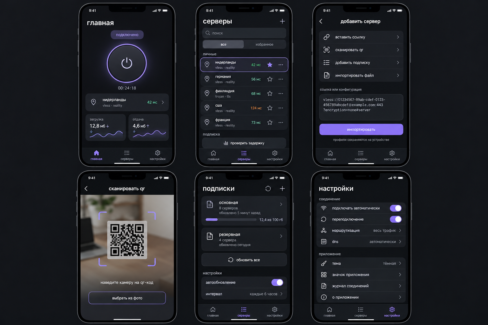

# baha vpn

нативный ios-клиент для собственных серверов на базе xray-core. swiftui, ios 17+.
приложение не выдаёт серверы и не продаёт доступ.



## протоколы и импорт

- vless и vmess: tcp/raw, websocket, grpc, httpupgrade, xhttp; tls, reality и vision в допустимых сочетаниях.
- trojan: tcp/raw, websocket, grpc, httpupgrade, xhttp и tls/reality.
- shadowsocks: sip002, legacy base64, aead и shadowsocks 2022.
- hysteria2: hy2/hysteria2, tls, salamander, bandwidth и переключение портов через параметры ports/mport.
- wireguard: wireguard/wg-ссылки и стандартные файлы conf; userspace-режим внутри xray.
- raw xray json: объект конфигурации, массив конфигураций, объект outbound, массив outbounds-объектов или оболочка configs.
- подписки: plain-text/base64 и xray json; импорт из буфера, файла, камеры qr, изображения qr и открытия ссылок.
- поиск, избранное, выбор и удаление серверов; tcp-задержка.

полная json-конфигурация остаётся одним профилем: outbounds, dns, routing, balancers,
observatory и policy сохраняются. ядро заменяет входящие локальные listeners одним системным tun,
сопоставляет их inboundTag с этим tun и отключает логи, чтобы не записывать секреты.
разные listeners с разными правилами невозможно одновременно представить одним packet flow.

json sing-box и yaml clash являются другими форматами и в этом клиенте не конвертируются.
sip003-плагины shadowsocks, insecure/pinsha256 из hysteria-ссылок и shell-команды wireguard conf
не подменяются похожими настройками: показывается явная ошибка.
импорт ограничен 8 мб и 2000 профилями. некорректный импорт/обновление не удаляет прежние серверы.

## маршрутизация

экран настроек поддерживает упорядоченные правила по доменам, ip/подсетям, портам и протоколам,
действия «через впн», «напрямую», «блокировка», обход локальной сети и стратегию разрешения доменов.
geosite/geoip используют файлы из официального релиза xray 26.9.30; архив проверяется по sha-256.
правила приложения применяются перед правилами json. настройки сохраняются и применяются
при следующем подключении. точные сложные правила можно импортировать в raw xray json.

## хранение и привязка устройства

состояние сохраняется атомарно в aes-gcm; ключ хранится в keychain.
старые сохранённые профили и настройки совместимы с новой версией.

при запросе подписки провайдер получает x-hwid, x-device-os, x-ver-os, x-device-model.
seed идентификатора хранится в keychain, не синхронизируется через icloud; sha-256 hwid вычисляется
отдельно для каждого домена провайдера. это не udid/imei. сервер определяет лимит устройств.
при смене домена через redirect заголовки устройства удаляются; для таких панелей нужна прямая ссылка.
ошибки лимита remnawave показываются отдельно. контракт:
https://github.com/remnawave/panel/blob/main/docs/features/hwid-device-limit.md.

профили не отправляются автору клиента. приложение обращается к введённым подпискам,
серверам и dns. конфигурация передаётся системному расширению через настройки впн;
новый cgo-мост запускает xray из памяти и не создаёт plaintext-файл профиля.

## ядро и сборка

используется полный официальный xray-core 26.9.30, commit
b26a91de4f3294e26a0ad0a970b81a386a41f789. исходники ядра не патчатся.
Native/ собирает cgo xcframework; Tunnel/ связывает официальный darwin tun и packet flow
через socketpair sock_dgram с сохранением границ пакетов. один процесс загружает один go runtime.

workflow ios prototype:
1. тесты импорта, json, конфигураций, hwid, маршрутизации и миграции состояния;
2. проверка json, сгенерированных swift-клиентом, настоящим xray;
3. проверка udp-пакета через tun до локального echo-сервера и повторного запуска ядра;
4. сборка full xray, приложения и packet tunnel для iphone;
5. упаковка unsigned ipa, сборка симулятора;
6. ui-тесты импорта ссылок/json и сохранения избранного после перезапуска, скриншот.

полное ядро и зависимости собираются дольше прежнего урезанного бинарника.
готовый xcframework кешируется по исходникам. артефакт baha-vpn-prototype содержит ipa,
приложение симулятора, preview.png и результаты ui-тестов. build-logs содержит логи.

unsigned ipa требует подписи apple developer для приложения и расширения
с capability network extensions → packet tunnel. успешная сборка и loopback-тест
не подтверждают авторизацию у настоящего провайдера; подключение к живым серверам
и расход памяти проверяются отдельно на iphone. tcp-задержка не является проверкой впн.
подписки автоматически обновляются при открытии приложения по выбранному интервалу.

## локальная сборка на macos

нужны xcode 16+, ios sdk/simulator, go 1.27.1 и xcodegen. подготовка:

```sh
brew install xcodegen
cd Core
BAHA_FIXTURES=../build/fixtures swift test
cd ..
python3 scripts/fetch_geo.py
python3 scripts/build_native.py
xcodegen generate
open BahaVPN.xcodeproj
```

выбери developer team и уникальные bundle identifiers для BahaVPN и PacketTunnel.
идентификатор расширения должен быть идентификатором приложения с суффиксом .tunnel.
app groups не требуются. simulator xcframework в текущем build script — arm64,
как у macos-15 runner; iphone target — arm64.

## структура и лицензии

App/ — интерфейс, шифрованное хранение, hwid, vpn manager и qr.
Core/ — импорт, подписки, конфигурации, маршрутизация и тесты.
Native/ — сборка полного xray и тест настоящего packet flow.
Tunnel/ — network extension.
project.yml — воспроизводимый xcode-проект.

исходный код клиента — mit. xray-core — mpl 2.0; оригинальная лицензия сохранена
в Native/Xray-core-LICENSE, исходники закреплённой версии:
https://github.com/XTLS/Xray-core/tree/b26a91de4f3294e26a0ad0a970b81a386a41f789.
go.mod/go.sum фиксируют зависимости; их лицензии остаются у соответствующих проектов.
